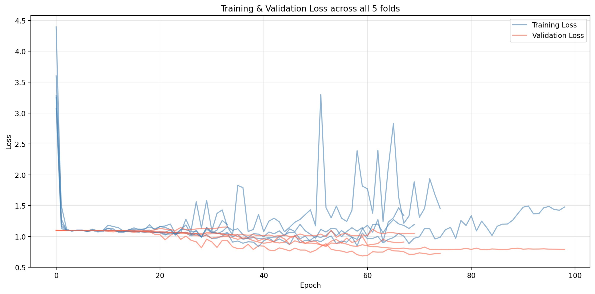

# Identification of Plant Deficiencies using a CNN Image Classification Model

A convolutional neural network that classifies leaf images as **nitrogen-deficient (N)**, **potassium-deficient (K)** or **healthy**. Early, automated detection of plant stress could help farmers act before yield is lost. Today that diagnosis is mostly manual, and different stressors often look alike.

Built as a team project in the USUDATA x Sydney Precision Data Science Centre Research Mentoring Program with Dr Pratibha Panwar.

> **Status:** research prototype. The model learns, but it only beats chance by a modest margin on a small, balanced subset of the data. See [Results](#results) and [What we learned](#what-we-learned).


📊 **[View the final presentation (PDF)](https://github.com/user-attachments/files/35045983/mentorship_final_presentation.pdf)**: problem, approach and results.


## Highlights

- Keras CNN with configurable depth (3–6 convolutional blocks) and filter counts
- **Stratified 5-fold cross-validation**, so every image is used for validation exactly once
- Systematic experiments on **network depth, filter count, colour jitter and zoom augmentation**
- Early stopping, learning-rate scheduling (`ReduceLROnPlateau`) and class weighting to fight overfitting and imbalance
- Evaluation beyond accuracy: per-class F1, macro F1, **Matthews correlation coefficient (MCC)**, AUPRC and expected calibration error (ECE)
- Per-fold and combined training and validation loss and accuracy curves
- A 3×3 convolution layer implemented from scratch in NumPy (`src/conv.py`) to understand the operation underneath the framework

## Dataset

**[OLID I: Open Leaf Image Dataset of Bangladesh's major crops](https://www.kaggle.com/datasets/raiaone/olid-i)** (Kaggle). It has 4,749 high-resolution (3024×3024) images in 57 classes of healthy, nutrient-deficient and pest-infested leaves from 8 crops.

We focused on nitrogen and potassium deficiency in three crops:

| Status | Eggplant | Cucumber | Tomato |
|---|---|---|---|
| Nitrogen (N) | 67 | 89 | 47 |
| Potassium (K) | 106 | 50 | 36 |
| Healthy | 92 | 34 | 236 |

The experiments below use a **balanced subset of 60 images per class (180 total)** to remove class imbalance as a confound. The images are not included in this repository. Put them in this layout:

```
data_v2/
├── K/
├── N/
└── healthy/
```

`DATA_ROOT` and `TRAIN_CLASS_FILTER` at the top of `src/cnn.py` select the data folder and the classes.

## Model

The final architecture has three Conv2D → MaxPool → Dropout blocks (32 → 64 → 64 filters, 3×3 kernels), followed by `Dense(64)` with dropout and a softmax output. It takes 256×256 RGB input and is trained with Adam and categorical cross-entropy for up to 100 epochs, with early stopping (patience 15). The dropout is heavy (0.4–0.6) because the dataset is small.

## Getting started

```bash
python3 -m venv .venv
source .venv/bin/activate          # Windows: .venv\Scripts\activate
pip install -r requirements.txt

python3 src/cnn.py
```

The script prints fold-by-fold metrics and saves loss and accuracy curves and a confusion matrix to the project root. Set `MODEL_ARCH` in `src/cnn.py` to try other depths.

## Results

All results are from 5-fold cross-validation on 180 images (3 balanced classes, so random guessing scores **33.3%**).

### Initial vs. updated model

| | Initial model | Updated model |
|---|---|---|
| Conv layers / filters | 4 / 32 (uniform) | 3 / 32 → 64 → 64 |
| Epochs | 10 | up to 100, early stopping |
| **Mean accuracy** | 42.8% ± 5.7% | **50.0% ± 7.9%** |
| Accuracy range | 36.1% – 52.8% | 36.1% – 58.3% |
| Macro F1 | 0.39 | 0.32 |
| MCC | 0.18 | 0.05 |
| F1 (K / N / healthy) | 0.58 / 0.13 / 0.46 | 0.38 / 0.46 / 0.13 |

Mean accuracy rose by 7.2 points, but macro F1 and MCC fell. The updated model's gains come mostly from predicting `N` more often, not from separating all three classes better. That's why we report MCC alongside accuracy.



### Hyperparameter tuning (mean CV accuracy)

| Filters | 16 | **32** | 64 | 128 | 256 |
|---|---|---|---|---|---|
| Accuracy | 0.43 | **0.48** | 0.43 | 0.42 | 0.40 |

| Conv layers | 3 | 4 | **5** | 6 |
|---|---|---|---|---|
| Accuracy | 0.38 | 0.42 | **0.43** | 0.38 |

More capacity didn't help. With 60 images per class, larger and deeper networks overfit.

### Data augmentation

| Augmentation | CV accuracy | Macro F1 | MCC | Note |
|---|---|---|---|---|
| Jitter: light | 0.356 | 0.355 | **0.195** | Healthy F1 = 0 |
| Jitter: medium | 0.328 | 0.222 | 0.146 | K improves, N collapses |
| Jitter: heavy | 0.333 | 0.167 | 0 | Too strong; collapses to one class |
| Zoom ×1.1 | 0.439 | **0.417** | 0.127 | Balanced improvement |
| Zoom ×1.2 | 0.372 | 0.286 | 0.129 | High K recall, N fails |
| Zoom ×1.4 | **0.444** | 0.387 | 0.155 | Best accuracy |

Geometric augmentation (zoom) helped. Strong colour jitter hurt, which makes sense because leaf colour is itself a key signal of nutrient deficiency.

## What we learned

- **Data size is the bottleneck.** With 60 images per class, a CNN trained from scratch barely beats chance, and adding filters or layers made it worse.
- **Augmentation must respect the signal.** Colour jitter destroys the yellowing cues that indicate N and K deficiency. Zoom keeps them.
- **Accuracy alone is misleading.** MCC and per-class F1 exposed models that collapse onto one or two classes even when their accuracy improved.
- **Pipeline bugs can look like modelling problems.** An early version was stuck at exactly 33.3% because image indices and DataFrame rows were misaligned. Fixing the data pipeline had to come before any tuning.

**Next steps:** transfer learning from an ImageNet-pretrained backbone, training on the full (imbalanced) set of 757 images with class weighting, more deficiency types and crops, and testing on a held-out set the model has never seen.

## Project structure

```
src/
├── cnn.py                 # Data loading, model definitions, k-fold training, plots
├── conv.py                # 3×3 convolution layer implemented from scratch in NumPy
├── confusion_matrix.py    # Standalone evaluation scripts
├── per_class_recall.py
├── MCC.py
├── AUPRC.py               # (PyTorch-based)
└── ECE.py                 # (PyTorch-based)
cnn_filters.py             # Filter-count experiment
docs/images/               # Figures used in this README
```

## Team

**Ananya Agarwal, Felix Chan, Matthew Ho.** Mentor: **Dr Pratibha Panwar**.
